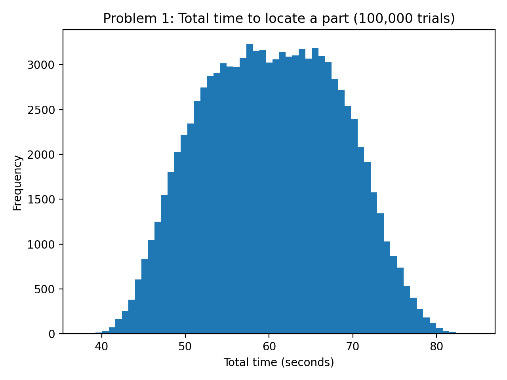
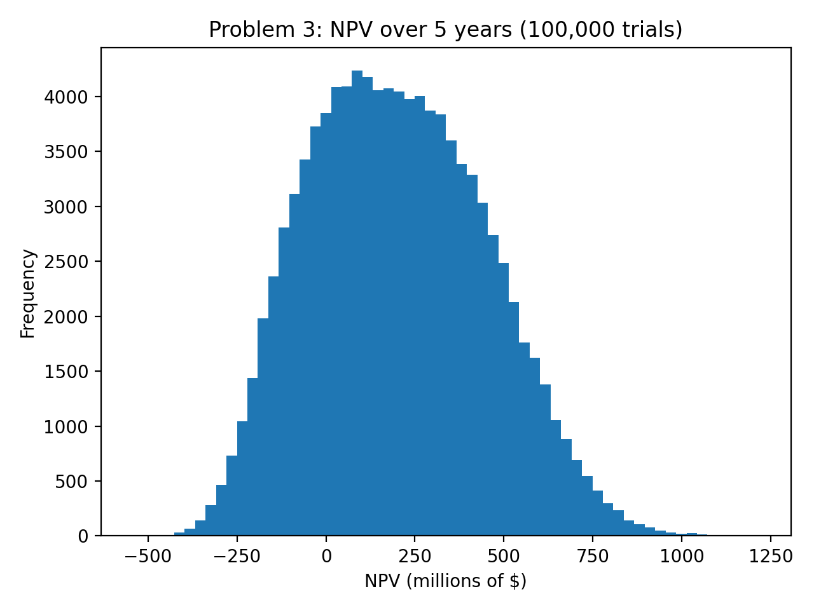
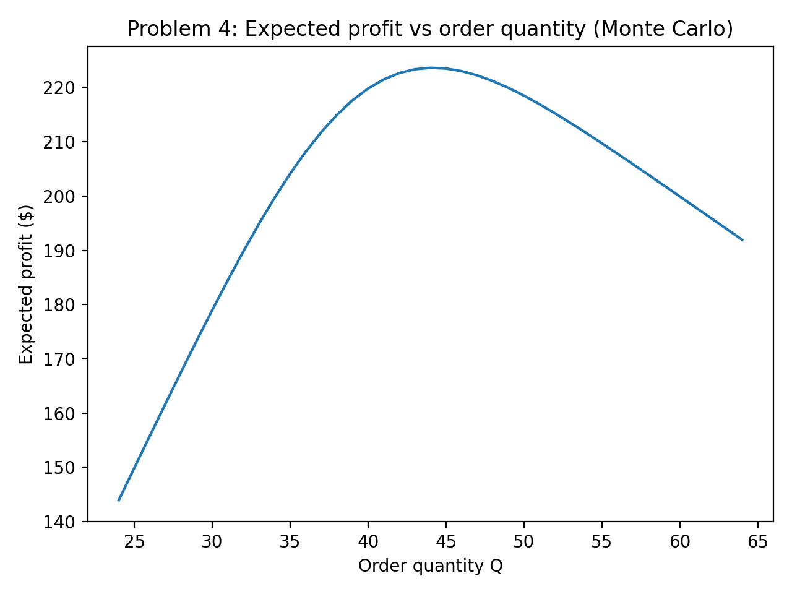
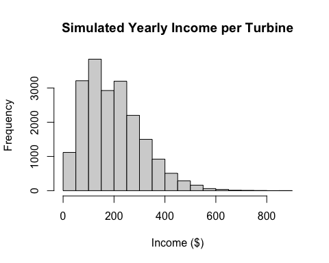

# Simulation & Optimization: Monte Carlo, Input Analysis and Discrete-Event Simulation

**Python (NumPy, Matplotlib, SimPy, PuLP) · R (MASS, fitdistrplus, car)** · Texas Tech University, M.S. Data Science · ISQS 7339 Simulation & Optimization · Spring 2026

## Overview
Coursework from my graduate Simulation & Optimization course: models that put numbers on uncertainty so a decision can be made with eyes open. The work covers linear programming, Monte Carlo simulation, random-number generation, input analysis (fitting distributions to real data), bootstrapping, the newsvendor inventory model, and discrete-event simulation of queues with SimPy.

## What's inside
| Assignment | Problem | Methods | Files |
|---|---|---|---|
| HW1 | Production planning: maximize profit 50·x₁ + 40·x₂ under three capacity constraints | Linear programming with PuLP (CBC solver), sensitivity analysis (slack and shadow prices) | [`scripts/HW1_linear_programming_pulp.py`](scripts/HW1_linear_programming_pulp.py) |
| HW3 | Travel time to locate a part; LCG random numbers; 5-year NPV of a new drug; newsvendor ordering | Monte Carlo simulation (100,000 trials), linear congruential generator, NPV under uncertainty, critical-fractile newsvendor | [`reports/HW3_…docx`](reports/HW3_Monte_Carlo_LCG_NPV_Newsvendor.docx) |
| HW4 | Wind-turbine technician income; median income (Prestige data); newsvendor with 100 days of real demand | Input analysis (Poisson vs. Negative Binomial; Normal / Lognormal / Gamma / Weibull compared by AIC), simulation, bootstrap CI (20,000 resamples), resampling optimization | [`scripts/HW4_…R`](scripts/HW4_input_analysis_bootstrap_newsvendor.R), [`notebooks/HW4_SO4.Rmd`](notebooks/HW4_SO4.Rmd), [`reports/HW4_…docx`](reports/HW4_Input_Analysis_Bootstrap_Newsvendor.docx) |
| HW5 | Call-center staffing, a two-machine shop, and an ER triage system | Discrete-event simulation in SimPy, 50 replications per scenario, 95% confidence intervals, utilization analysis, balking and reneging | [`reports/HW5_…docx`](reports/HW5_Discrete_Event_Simulation_SimPy.docx) |

## Key results (from the reports)
**Monte Carlo (HW3)**
- Total travel time T = X + Y + Z: mean **60.296 s**, SD **8.097 s**; P(T > 70 s) = **0.1295**.
- LCG (m = 200, a = 17, c = 1, R₀ = 5): U₁ = 0.43, U₂ = 0.315, U₃ = 0.36.
- New-drug 5-year NPV: mean **$200.7M**, SD **$248.0M**; probability the project loses money (NPV < 0) = **23.6%**.
- Newsvendor with Poisson demand (mean 40/day), cost $12, price $18, salvage $10: critical fractile **0.75**, optimal order **Q\* ≈ 44 units/day**, confirmed by simulating expected profit across order quantities.

**Input analysis, bootstrapping and resampling (HW4)**
- Chose a discrete model for failure counts (Poisson vs. Negative Binomial, based on mean vs. variance) and the best-AIC continuous model for repair and drive times, then simulated 20,000 years of technician income ($2/min × (repair + drive) × failures) with mean, SD, histogram and 95% CI.
- Bootstrapped the median of `Prestige$income` with a 95% percentile interval.
- Newsvendor resampling on the 100-day demand file: searched every order quantity, picked the profit-maximizing Q\*, and reported a 95% interval for profit at Q\*.

**Discrete-event simulation with SimPy (HW5)**
- One shared queue vs. two separate operator queues: mean wait **1.72 min vs. 3.83 min** (difference 2.10 min).
- Three operators: mean waits **14.7, 15.8 and 26.0 min** (95% CIs 11.4–18.1, 12.6–19.1, 21.6–30.3). Operator 3's longer service time (mean 15 vs. 12.5 min) pushes her utilization toward 1 and makes her the bottleneck.
- Two-machine shop: average flow time **9.9 min** for Type 1 parts vs. **23.6 min** for Type 2 (longer setup and service).
- ER triage (1 nurse, 3 doctors, 8-hour day): mean flow time **66.9 min** for high-priority and **36.7 min** for low-priority patients; low-priority patients balk **42.5%** of the time (and renege 23.2%).

## Charts
| Monte Carlo travel time (HW3) | Drug NPV distribution (HW3) |
|---|---|
|  |  |
| **Newsvendor expected profit vs. order quantity (HW3)** | **Simulated technician income per turbine (HW4)** |
|  |  |

More output charts (HW4 histograms and bootstrap distribution, HW5 utilization and waiting-time plots) are in [`images/`](images).

## Repo structure
```
scripts/    HW1 linear program (Python/PuLP), HW4 R scripts
notebooks/  HW4 R Markdown
reports/    HW3, HW4, HW5 write-ups with code, output and interpretation (HW3 and HW5 code lives inside the reports)
data/       wind-turbine and newsvendor demand data provided in the course (small, non-sensitive)
images/     charts exported from the reports
```

## How to run
- **Python:** `pip install pulp numpy matplotlib simpy scipy`, then `python scripts/HW1_linear_programming_pulp.py`.
- **R:** the HW4 script reads the CSVs from the working directory, so run it from `data/`: `cd data && Rscript ../scripts/HW4_input_analysis_bootstrap_newsvendor.R` (installs MASS, fitdistrplus and car if missing).

## Skills demonstrated
Monte Carlo simulation · probability modeling · distribution fitting (input analysis) · bootstrapping · inventory optimization (newsvendor) · linear programming and sensitivity analysis · discrete-event simulation · confidence intervals · communicating risk to decision-makers

---
**Jada Malone** · Data Analyst · M.S. Data Science, Texas Tech University · [GitHub profile](https://github.com/jada-malone) · [LinkedIn](https://www.linkedin.com/in/jada-malone-509170280)
